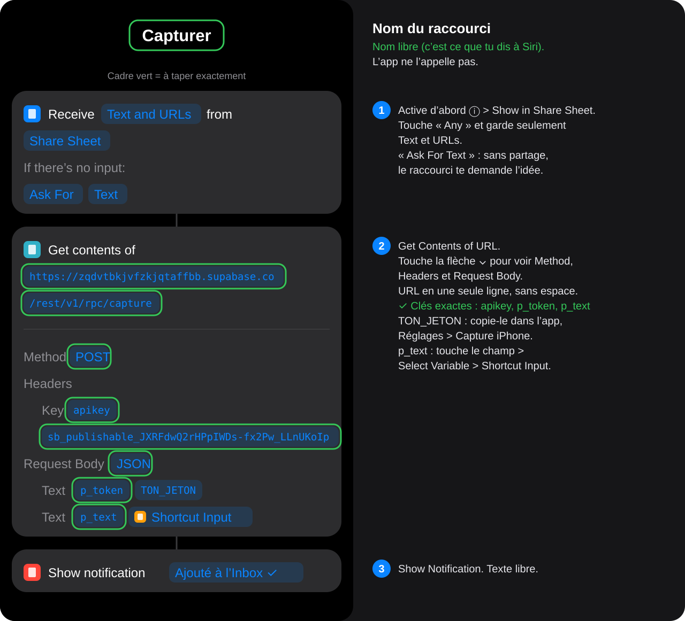
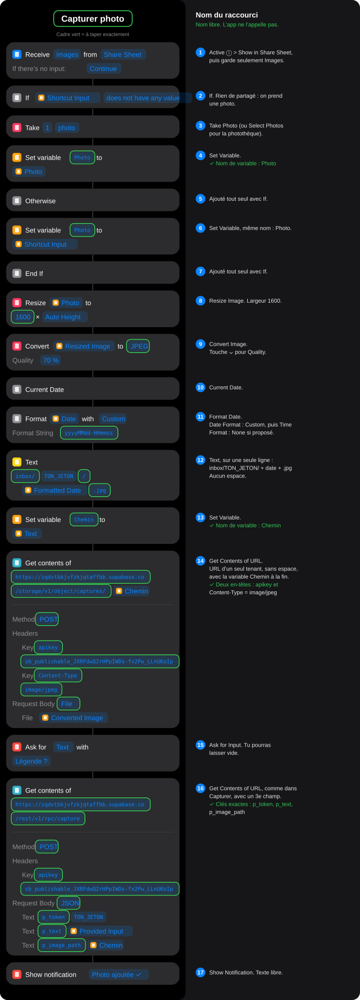
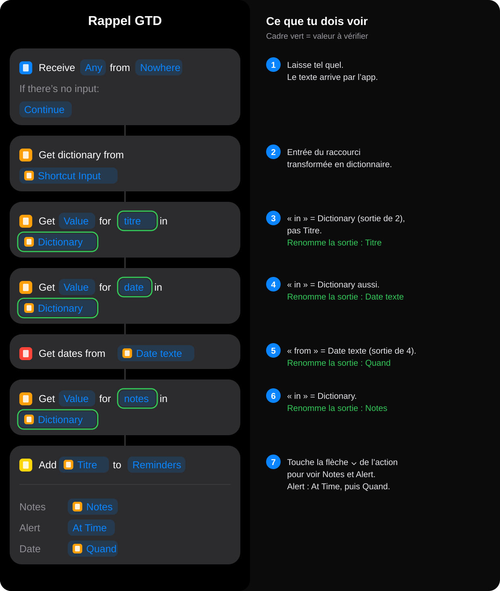

# Second Cerveau

PWA personnelle de type GTD : capture rapide depuis l'iPhone, tri de l'Inbox, prochaines actions par contexte, projets, notes et signets liés aux tâches, et planification de la journée. Les données sont synchronisées avec Supabase et l'app fonctionne hors ligne.

- **App** : https://maximecongard-hash.github.io/second-cerveau/
- **Démo sans compte** : https://maximecongard-hash.github.io/second-cerveau/?demo=1 (données fictives, stockées seulement dans le navigateur)
- **Code** : https://github.com/maximecongard-hash/second-cerveau

L'app est servie par GitHub Pages depuis la branche `main` : chaque push y est publié en quelques minutes.

---

## 1. Préparer Supabase (une seule fois)

1. Supabase > **SQL Editor** > **New query**.
2. Colle tout le contenu de [`supabase/schema.sql`](supabase/schema.sql) puis clique sur **Run**. Le message attendu est « Success. No rows returned ».
3. Vérifie que ton utilisateur existe bien (Authentication > Users) et que les inscriptions sont désactivées (Authentication > Sign In / Providers > « Allow new users to sign up » décoché).

Le script crée :

| Élément | Rôle |
|---|---|
| table `items` | inbox, tâches, projets, domaines, notes et signets |
| table `prefs` | contextes, date de la dernière revue… |
| table `capture_tokens` | jetons secrets utilisés par les raccourcis iPhone |
| fonction `capture()` | ajoute un élément dans l'Inbox à partir d'un jeton |
| bucket `captures` | photos (privé) |

Chaque table est protégée par des règles RLS : seul ton compte connecté voit ses données. Les raccourcis ne peuvent qu'**ajouter** dans l'Inbox, et seulement avec un jeton valide.

Base créée avant une mise à jour : colle aussi, dans l'ordre, les migrations qui manquent. Chaque script peut être relancé sans risque. Une installation neuve n'en a pas besoin, `schema.sql` est déjà à jour.

- Avant la version 0.2 : [`supabase/002_pack1.sql`](supabase/002_pack1.sql) (Top 3, résultat attendu, date de revue).
- Avant la version 0.5 : [`supabase/003_liens.sql`](supabase/003_liens.sql) (liens entre tâches, notes et projets, épingle). Sans elle, la pastille de synchro passe en erreur.
- Avant la version 0.6 : [`supabase/004_signets.sql`](supabase/004_signets.sql) (signets, et types d'éléments ouverts aux nouveaux modules). Sans elle, enregistrer un signet échoue.

## 2. Installer l'app sur l'iPhone

1. Ouvre https://maximecongard-hash.github.io/second-cerveau/ dans **Safari**.
2. Connecte-toi avec l'email et le mot de passe créés dans Supabase.
3. Facultatif : menu **⋯** > **Réglages** > **Icône**, choisis **Encre** (fond sombre) ou **Papier** (fond clair). iOS fige l'icône au moment de l'ajout : pour en changer plus tard, supprime l'app de l'écran d'accueil et ajoute-la de nouveau.
4. Bouton **Partager** (*Share*) > **Sur l'écran d'accueil** (*Add to Home Screen*) > **Ajouter** (*Add*).
5. Ouvre l'app depuis l'icône : elle s'affiche en plein écran, comme une app native.

## 3. Générer ton jeton de capture

Dans l'app : menu **⋯** > **Réglages** > **Capture iPhone** > **Générer un jeton**, puis **Copier**.

Ce jeton permet d'ajouter des éléments dans ton Inbox. Garde-le pour toi ; s'il fuit, révoque-le dans les Réglages et génères-en un autre.

Tu colleras ce jeton en installant les raccourcis (étape 4). Si tu le révoques, réinstalle Capturer et Capturer photo avec le nouveau jeton.

## 4. Installer les raccourcis iPhone

Les trois raccourcis sont déjà prêts. Tu n'as rien à construire : tu les installes, tu colles ton jeton, c'est tout.

| Raccourci | À quoi il sert |
|---|---|
| **Capturer** | Noter une idée (texte ou dictée) ou un lien partagé, qui arrive dans l'Inbox. |
| **Capturer photo** | Prendre ou partager une photo, avec une légende, qui arrive dans l'Inbox. |
| **Rappel GTD** | Lancé par l'app quand tu touches « Créer un rappel Apple » dans une tâche. |

### Avant : supprime tes anciens raccourcis

Si tu avais déjà construit des raccourcis à la main (par exemple « CAPTURER », « Capturer_photo », « Rappel BRAIN »), supprime-les pour ne pas les confondre : app **Raccourcis**, appui long sur le raccourci > **Supprimer** (*Delete*).

### Installer

Pour chaque raccourci, **sur l'iPhone, dans Safari** :

1. Touche le lien :
   - [Capturer](https://maximecongard-hash.github.io/second-cerveau/raccourcis/Capturer.shortcut)
   - [Capturer photo](https://maximecongard-hash.github.io/second-cerveau/raccourcis/Capturer%20photo.shortcut)
   - [Rappel GTD](https://maximecongard-hash.github.io/second-cerveau/raccourcis/Rappel%20GTD.shortcut)
2. Safari demande s'il faut télécharger le fichier : touche **Télécharger** (*Download*).
3. Touche l'icône de téléchargement (flèche bleue dans la barre d'adresse), puis le fichier. L'app Raccourcis s'ouvre.
4. Touche **Configurer le raccourci** (*Set Up Shortcut*). Pour Capturer et Capturer photo, l'iPhone te demande ton jeton : dans l'app Brain, menu **⋯** > **Réglages** > **Capture iPhone** > **Copier**, puis colle-le ici.
5. Touche **Ajouter le raccourci** (*Add Shortcut*).

Le nom **Rappel GTD** doit rester tel quel : l'app lance ce raccourci par son nom. Si tu le renommes, tape le nouveau nom dans l'app, Réglages > Rappels Apple.

### Essayer

- **Capturer** : lance-le, tape « test », valide. « test » apparaît dans l'Inbox de l'app.
- **Capturer photo** : lance-le, prends une photo, laisse la légende vide. Elle apparaît dans l'Inbox.
- **Rappel GTD** : dans l'app, ouvre une tâche avec une date, touche **Créer un rappel Apple**. Un rappel apparaît dans l'app Rappels (à 9 h 00 si la tâche n'a pas d'heure).

La première fois, l'iPhone demande s'il peut se connecter à `supabase.co` ou accéder à tes Rappels : touche **Toujours autoriser** (*Always Allow*).

### Utiliser Capturer au quotidien

- **Bouton Action** (iPhone 15 Pro et plus) : Réglages > Bouton Action > Raccourci > Capturer.
- **Siri** : « Dis Siri, Capturer ».
- **Widget** Raccourcis sur l'écran d'accueil ou l'écran verrouillé.
- **Partage** depuis Safari, YouTube, X… : Partager > Capturer. Le lien arrive dans l'Inbox.

Un lien seul est reconnu automatiquement. Pour un texte sur plusieurs lignes, la première ligne devient le titre et le reste les détails.

## 5. Ce qu'il y a dans chaque raccourci

Tu n'as pas besoin de lire cette partie pour utiliser les raccourcis. Elle montre ce que tu vois si tu ouvres un raccourci dans l'app Raccourcis, et sert si un jour il faut en réparer un.

### Trois mots à connaître

- **Action** : une étape du raccourci (une carte grise). Les actions s'exécutent de haut en bas.
- **Résultat** (Apple dit *output*, parfois traduit par « sortie ») : ce que produit une action. Par exemple, l'action « Format Date » produit un texte comme `20261031-154512`. Les actions suivantes peuvent réutiliser ce résultat : il apparaît alors comme une **puce avec une petite icône orange** et un nom (`Jeton`, `Chemin`, `Titre`…).
- **Shortcut Input** (entrée du raccourci) : ce que le raccourci reçoit au départ, par exemple le texte ou le lien que tu partages.

Dans les images, un **cadre vert** entoure ce qui doit être exactement comme ça pour que l'app fonctionne (adresse, clés, noms). Le jeton n'est jamais montré : c'est toi qui l'as collé à l'installation.

### Capturer



### Capturer photo



### Rappel GTD

L'app envoie au raccourci trois informations : `titre`, `date` et `notes`. Le raccourci les lit une par une, puis crée le rappel.



### Refaire les fichiers des raccourcis

Les fichiers de `raccourcis/` sont fabriqués par [`raccourcis/build.py`](raccourcis/build.py), sur un Mac : `python3 raccourcis/build.py`. Le script les signe avec l'outil `shortcuts` du Mac, ce qui permet de les installer sur n'importe quel iPhone.

## 6. Utilisation au quotidien

- **Dans la journée** : tu captures tout avec le bouton Action, Siri ou le partage. Pas besoin de trier.
- **Le soir** : onglet Inbox > **Trier**. Pour chaque élément : fait, aujourd'hui, prochaine action, projet, en attente, un jour, note, signet ou suppression. Un élément partagé avec un lien propose d'emblée « Signet ».
- **Le matin ou la veille** : onglet Aujourd'hui > **Choisir dans mes prochaines actions**. Ajoute une heure aux tâches qui doivent tomber à un moment précis ; elles passent dans l'Agenda.
- **Chaque semaine** : menu **⋯** > **Revue hebdo**.

Le point en haut à droite indique la synchro : vert = synchronisé, orange = en cours, gris = hors ligne (tes modifications restent sur le téléphone et partent au retour du réseau), rouge = erreur (détail dans Réglages).

## 7. Modules (thèmes)

L'app est organisée en modules, affichés dans une barre latérale : fixe sur grand écran, ouverte avec le bouton ☰ sur iPhone.

- **Organisation** : le GTD (Inbox, Aujourd'hui, Actions, Projets).
- **Notes** : notes en Markdown, signets à lire ou lus, éléments épinglés. Chaque note ou signet peut être lié à des tâches et des projets (« Liés », « + Lier à… », « + Action liée »).
- **Sport** et **Courses** : en aperçu, désactivés par défaut.

Menu **Modules** (dans la barre ou les Réglages) : active ou masque chaque module et change leur ordre. Le premier module s'ouvre au lancement. Ce choix est enregistré dans tes préférences et synchronisé entre tes appareils.

## Fichiers

| Fichier | Rôle |
|---|---|
| `index.html`, `styles.css` | page et styles |
| `js/main.js` | point d'entrée : charge le cœur puis les modules |
| `js/core/` | cœur commun : état, synchro Supabase, rendu, barre latérale, réglages, recherche |
| `js/core/modules.js` | registre des modules (la liste des propriétés d'un module y est décrite) |
| `js/modules/<module>/` | un dossier par module (`gtd`, `notes`, `sport`, `courses`) |
| `config.js` | URL et clé publique Supabase |
| `sw.js` | cache hors ligne : change `CACHE` à chaque nouvelle version et ajoute chaque nouveau fichier de `js/` à `SHELL` |
| `manifest.webmanifest`, `icons/` | installation sur l'écran d'accueil |
| `supabase/schema.sql` | base de données complète (installation neuve) |
| `supabase/00N_*.sql` | migrations pour une base existante |
| `AGENTS.md`, `CLAUDE.md` | consignes pour les agents de code |

### Ajouter un module

1. Crée `js/modules/<nom>/index.js` et appelle `registerModule({...})` (voir `js/modules/sport/index.js`).
2. Importe-le dans `js/main.js`.
3. Ajoute ses fichiers à `SHELL` dans `sw.js` et incrémente `CACHE`.

### Tester en local

```bash
python3 -m http.server 5173
```

Puis ouvre `http://localhost:5173/?demo=1`.

### Publier une nouvelle version

1. Incrémente `VERSION` dans `js/core/config.js` **et** `CACHE` dans `sw.js` (sinon l'iPhone garde l'ancienne version).
2. Pousse sur `main` : GitHub Pages publie l'app.
3. À la prochaine ouverture, l'app installée récupère la nouvelle version et se recharge d'elle-même.
